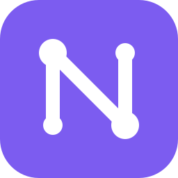

# NexoMF

**Gerenciador de conexões remotas para Windows: RDP, SSH, VMware e Proxmox em abas, com cofre de credenciais.**

Este repositório contém apenas os **executáveis** do NexoMF. O app procura atualizações aqui.

## Download

Baixe a versão mais recente em [**Releases**](../../releases/latest):

- `NexoMF-<versão>-win-x64.exe`: executável único, sem instalação (Windows 10 1809+ / 11, 64 bits)
- `NexoMF-<versão>-win-x64.zip`: o mesmo executável, compactado
- `SHA256SUMS.txt`: somas de verificação

O executável ainda não é assinado digitalmente: se o SmartScreen avisar, use **Mais informações → Executar assim mesmo**.

## Atualizações

A partir da versão 0.3.0, o NexoMF avisa quando há uma versão nova e se atualiza sozinho (com a sua confirmação),
conferindo o SHA-256 do arquivo baixado.
